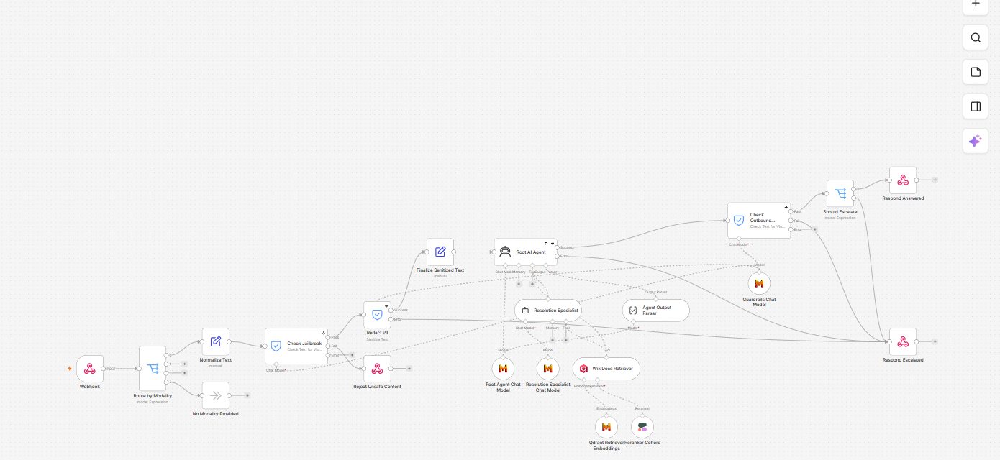
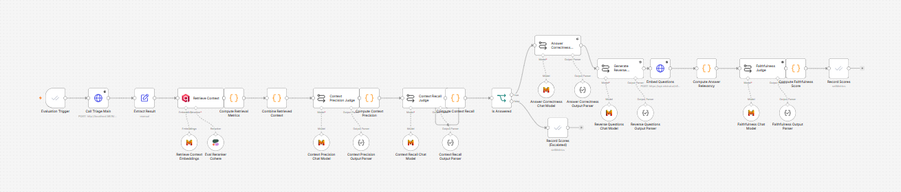
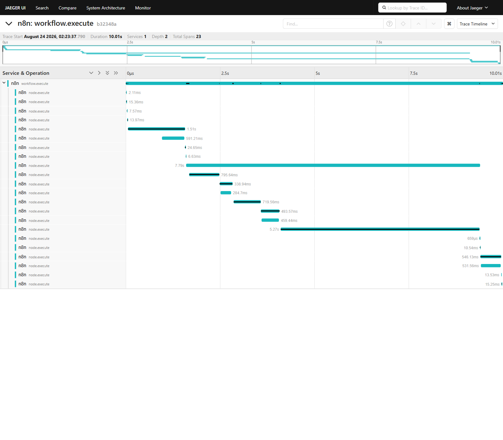

# TriagePilot

A self-hosted, n8n-based multi-agent RAG system that triages support tickets. It answers
directly when it can ground the answer in real documentation, escalates to a human when it
can't, and runs guardrails on every request and response to block or redact unsafe content.

Support backlogs are expensive. A 500-ticket backlog, even with a small churn increase from slow
response times, can cost a business six figures a quarter, and most service desks still spend
the bulk of their budget on staff rather than on tooling that could clear that backlog faster.

**Results at a glance:** two independent deployments, real RAGAS Faithfulness of 0.89 (Wix) and
0.85 (TechQA), in the same range as published production RAG systems report (around 0.89-0.90).
Full metrics and how they were measured are in [Evaluation](#evaluation) below.

**Contents:** [Architecture](#architecture) · [Tech stack](#tech-stack) ·
[Running it locally](#running-it-locally) · [Evaluation](#evaluation) ·
[Observability](#observability) ·
[What's deliberately not included](#whats-deliberately-not-included) ·
[Current status](#current-status)

## Architecture

```
Webhook (text)
  -> Guardrails (inbound): jailbreak detection, PII, secrets
       - fail -> log + safe refusal response
  -> Root Triage Agent (Qdrant retriever tool attached)
       - confident answer -> respond directly
       - needs deeper handling -> hand off to Resolution Sub-Agent
       - ambiguous / low confidence -> escalate to a human
  -> Resolution Sub-Agent (nested AI Agent Tool)
       - second retrieval pass and/or tool call, returns result to the root agent
  -> Guardrails (outbound): jailbreak check on the response before it ships
  -> Response sent (or routed to a human review queue if flagged)

Parallel, independent paths:
  - Two Evaluation Trigger + Data Table workflows (Wix, TechQA), scored with real RAGAS
    methodology (Faithfulness, Answer Relevancy, Context Precision, Context Recall, RAGAS
    Overall) plus Hit Rate@K / Mean Reciprocal Rank for retrieval quality
  - A Cohere reranker sits between Qdrant's initial vector fetch and the agent's final context:
    widen to topK=15, cross-encode, keep the best topN
  - OpenTelemetry: every workflow and node execution exports a trace span to Jaeger
```

Two independently deployed and evaluated systems back this: one on a real Wix help-center
knowledge base with real customer tickets (the WixQA benchmark), one on real IBM technical
support documentation with real developer-forum questions (the TechQA benchmark). They share
the workflow design and nothing else. Separate Qdrant collections, separate webhooks, so
changing one never touches the other.


*The live n8n canvas for the Wix triage workflow: the webhook and guardrails on the left, the
root agent in the middle, the resolution sub-agent and Qdrant retriever below it, escalation
routing on the right.*

Workflow JSON lives in `workflows/`:

- `06-ingest-wix-docs.json` / `09-ingest-techqa-docs.json`: one-time ingestion into Qdrant
- `07-triage-main-wix.json` / `10-triage-main-techqa.json`: the webhook-triggered triage flow,
  pointed at each knowledge base
- `08-evaluation-wix.json` / `11-evaluation-techqa.json`: evaluation against each real dataset

## Tech stack

| Piece | Implementation |
|---|---|
| Orchestration | Self-hosted n8n (Docker), webhook trigger |
| RAG | n8n's native Document Loader -> Text Splitter -> Embeddings -> Vector Store nodes |
| Vector DB | Qdrant (self-hosted, Docker) |
| Multi-agent | AI Agent node (root) + nested AI Agent Tool node (resolution sub-agent) |
| Guardrails | n8n's native Guardrails node: jailbreak detection, PII, and secrets inbound; jailbreak-only outbound |
| Reranking | Cohere `rerank-v3.5`, added after diagnosing retrieval-precision misses where the right document existed but a topically-adjacent one got retrieved instead |
| Evaluation | n8n's native Evaluation Trigger + Data Table, real RAGAS methodology: claim-decompose-and-verify Faithfulness, reverse-question cosine-similarity Answer Relevancy, Context Precision/Recall, plus Hit Rate@K and Mean Reciprocal Rank for retrieval |
| Observability | n8n's native OpenTelemetry tracing, exported to self-hosted Jaeger over OTLP |
| Chat / reasoning | Mistral AI (`mistral-small-latest`) |
| Embeddings | Mistral AI (`mistral-embed`), same model at ingestion time, query time, and in the Answer Relevancy metric |
| Knowledge bases | A real Wix help-center corpus and real IBM technical support Technotes |

## Running it locally

```bash
cd infra
docker compose up -d
docker compose ps

# health checks
curl -s http://localhost:5678/healthz
curl -s http://localhost:6333/healthz
curl -s http://localhost:6333/collections/wix_help_center_docs

# send a real triage request
curl -s -X POST http://localhost:5678/webhook/triage-wix \
  -H "Content-Type: application/json" \
  -d '{"text": "How do I add a coupon to my Wix Stores checkout?"}'
```

Import the six workflow JSON files into your own n8n instance, wire up a Mistral Cloud
credential, a Qdrant credential, and a Cohere credential, then build each corpus locally
(`pip install pandas` is the only dependency) and point the matching ingestion workflow at its
output before running the matching query workflow:

```bash
python eval/prepare_wix_corpus.py      # writes infra/local_files/wix-docs/
python eval/prepare_techqa_corpus.py   # writes infra/local_files/techqa-docs/
```

## Evaluation

Two non-synthetic datasets, each built from a different product's real support content:

- **Wix**: `eval/prepare_wix_corpus.py` builds a corpus from a real Wix help-center KB, paired
  with 200 real customer support questions and expert-reviewed answers (`Wix/WixQA` on Hugging
  Face). Each question links to its real source article, so the eval set is answerable from the
  corpus by construction.
- **TechQA**: `eval/prepare_techqa_corpus.py` builds a corpus from 496 real IBM Technotes,
  paired with 608 real questions from IBM's developer support forums, each grounded in exactly
  one Technote (`nvidia/TechQA-RAG-Eval` on Hugging Face).

Both Evaluation workflows run a sample through the live triage webhook and score every response
with real RAGAS methodology, not a metric that's just named after it: Faithfulness decomposes
the answer into atomic claims and checks each against retrieved context; Answer Relevancy
reverse-engineers questions from the answer and compares them to the real question by cosine
similarity; Context Precision and Context Recall score whether the retrieved chunks were
actually relevant and whether the reference answer is traceable back to them; RAGAS Overall is
the mean of those four. Answer Correctness, a direct 1-5 comparison against ground truth, is
kept as a supplementary fifth metric.


*The live n8n canvas for the Wix evaluation pipeline: retrieval and context scoring on the left,
the answered/escalated branch in the middle, Answer Correctness / Answer Relevancy / Faithfulness
judges on the right, all feeding into Record Scores.*

Real 30-row results, same live methodology for both systems, full run history and diagnosis in
`eval/RESULTS.md`:

| Metric | Wix (30) | TechQA (30) |
|---|---|---|
| Answer Correctness (1-5, supplementary) | 4.00 / 5 | 4.63 / 5 |
| Answer Relevancy | 0.88 | 0.87 |
| Faithfulness (RAGAS) | **0.89** | **0.85** |
| Context Precision | 0.81 | 0.79 |
| Context Recall | 0.76 | 0.80 |
| RAGAS Overall | **0.85** | **0.84** |
| Hit Rate@K | 0.90 | 0.93 |
| Mean Reciprocal Rank | 0.72 | 0.83 |
| Answered | 26 / 30 | 27 / 30 |

Published production RAG systems commonly report a RAGAS Faithfulness figure around 0.89-0.90;
both systems land in that range. Hit Rate@K and Mean Reciprocal Rank (whether the ground-truth
source document showed up in the retrieved chunks, and how high it ranked) are computed
automatically inside each Evaluation workflow, including on escalated rows, since retrieval
happens before the agent decides whether to answer.

The Wix numbers reflect a real fix made mid-evaluation: three low-scoring rows traced back to
two retrieval-precision misses and one genuine gap in the corpus. A Cohere reranker fixed the
two retrieval misses; the corpus gap stayed, since no retrieval tuning recovers a fact that was
never ingested. Full diagnosis, including a trade-off the reranker introduced on one row, is in
`eval/RESULTS.md`.

## Observability

Every workflow execution exports an OpenTelemetry trace to a self-hosted Jaeger instance: one
root span per request, with a child span for every node that ran (guardrails checks, the
retriever, the agent, the response). A real trace, captured from an actual request:



## What's deliberately not included

These were researched and considered, then scoped out deliberately, not left unfinished:

- **GraphRAG**: plain vector RAG covers support-ticket retrieval well; graph cross-referencing
  fits a different kind of domain, like contract review, better than this one.
- **Self-correcting reflection loop**: a reasonable future addition, deferred to keep scope
  tight.
- **Semantic caching**: a real cost win, but orthogonal to what this project is demonstrating.
- **MCP server exposure and multimodal input**: both were built and verified against a different
  corpus in an earlier iteration, but aren't part of what's published here.

## Current status

Runs on local Docker Compose (n8n, Qdrant, Jaeger). Every workflow is exported to JSON and
committed regardless of host, so moving to a cloud VM later means standing up the same stack
elsewhere and re-importing the JSON, not rebuilding anything.
