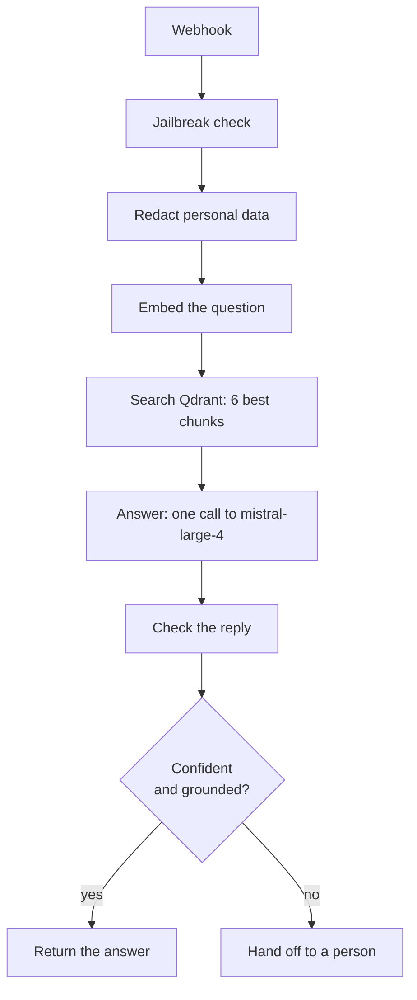

# TriagePilot

[](https://github.com/bejad21/TriagePilot/actions/workflows/tests.yml)

A retrieval-augmented support-triage pipeline that answers customer questions from a knowledge base, or hands them to a person when it should not answer. It is deployed on two knowledge bases, Wix help-center articles and IBM TechQA notes, as two examples of the same design, and each is evaluated separately. This repository keeps the results, the method and the experiments that did not work.

**Stack:** n8n, Qdrant, `mistral-large-4`, `nemotron-3.5-embed-8b`, Docker, a Python evaluation harness.

## What it does

The system follows retrieval-augmented generation (RAG): it searches a knowledge base for passages related to the question, gives them to a language model, and returns the answer. The pipeline is one design, deployed here on two knowledge bases: 1,200 Wix help-center articles and 496 IBM technical notes (TechQA). Each deployment has its own n8n workflow, vector collection and webhook, and is evaluated on its own.

The project tests how far a plain pipeline gets on real support content, and reports the results as measured.

## Results

Each dataset is evaluated separately: 200 questions were sent through its own running webhook, and the two columns are never pooled. Score = (good answers sent minus wrong answers sent) / questions. A hand-off to a person counts as zero.

| | Wix | TechQA |
|---|---|---|
| Answered / handed to a person | 190 / 10 | 169 / 31 |
| Good answers sent | 170 | 156 |
| Wrong answers sent | 20 (10.5% of answers sent) | 13 (7.7% of answers sent) |
| Score (95% interval) | +0.750 (+0.660 to +0.835) | +0.715 (+0.635 to +0.795) |
| Time per request, median (free shared model endpoint) | 161 s | 190 s |

To regenerate this table from the saved answers and grades:

```bash
cd eval
python results/final_numbers/final_numbers.py
```

Three judge models from different families grade each answer against the reference. [Evaluation](docs/evaluation.md) explains the method, the judges' agreement and the weak spots of grading against a reference.

The score says whether answers match the reference. These RAG metrics check the pipeline's parts, each dataset on its own:

| Metric | What it checks | Wix | TechQA |
|---|---|---|---|
| Faithfulness | Share of the answer's claims that the retrieved passages support (low means invented content) | 0.98 | 0.95 |
| Context precision | Share of the 6 retrieved chunks that are relevant, with higher ranks weighted more | 0.89 | 0.88 |
| Context recall | Share of the reference answer's statements found in the retrieved chunks | 0.84 | 0.87 |
| Hit rate at 3 articles | A known source document is among the first 3 articles found | 0.94 | 0.94 |
| Mean reciprocal rank | 1 / rank of the first source document (1.0 = always first) | 0.82 | 0.92 |
| Answer relevancy | How closely the answer addresses the question, from an embedding comparison (compare versions, not a pass mark) | 0.62 | 0.58 |

Intervals, the method (passages are rebuilt with the same search) and the few unscored rows are in [evaluation](docs/evaluation.md).

Speed and cost:

| | Wix | TechQA |
|---|---|---|
| **One row end to end on a normal model endpoint, median** | **about 9.6 s** | **about 9.3 s** |
| Of which the pipeline itself (guards, embedding, search), median | 1.7 s | 1.6 s |
| Tokens per request, mean (input / output) | 2,903 / 728 | 1,803 / 746 |
| Estimated cost per 1,000 requests at list price | about $3.6 to $7.0 | about $2.8 to $5.6 |

The first row comes from 15 clean calls per dataset to Mistral's own API; the evaluation itself ran on a shared free endpoint, where the same answer call took a median of 171 s and 193 s. The pipeline around the model call is under two seconds. Nothing was spent in this project; the cost row is an estimate from list prices that third-party sources quote differently ([details](docs/evaluation.md#speed-and-token-cost)).

## Key findings

- **A simple pipeline held up.** Whole articles for Wix and a larger answer model helped. Hybrid search, a reranker, a rewritten prompt set, a second model that checks each draft, clarifying questions, and more reasoning effort in the answer model did not. [Experiments](docs/experiments.md) has the numbers and the final tables for each.
- **Scores are noisy.** Replaying the same system twice moved the score by about 0.04 to 0.05, so smaller differences are treated as chance.
- **The 33 remaining wrong answers are hard to remove.** Eight come from reference answers that do not fit the question (they stay in the numbers; without them the scores are +0.786 and +0.750, see the [list](eval/results/final_numbers/unclear_labels.md)). The rest are partial answers, similar-but-wrong pages, and documents the search missed.
- **A stronger answer model is the most likely route to better results.** The larger model was the only change that cut wrong answers sent (Wix 27 to 14 in the model comparison), so a stronger model is expected to help further. Nothing above `mistral-large-4` has been tested.

## How it works



- **Search:** the customer's own words are embedded and matched against Qdrant. There is no reranker and no keyword search.
- **Context:** TechQA gives the model the 6 best chunks. Wix gives it the top 3 articles whole, because Wix answers often sit outside the best chunk.
- **Checks:** a small guard model screens the question and the reply. It caught 42 of 42 test attacks ([security tests](docs/security-tests.md)).
- **Escalation:** an empty search, low confidence or a review flag sends the case to a person and raises a Telegram alert.

More detail is in [architecture](docs/architecture.md).

## Quick start

No API keys are needed to check the tests and the numbers:

```bash
git clone https://github.com/bejad21/TriagePilot.git
cd TriagePilot/eval
python -m venv .venv
source .venv/bin/activate        # on Windows: .venv\Scripts\activate
pip install pandas pyarrow numpy scipy requests pytest
python -m pytest -q
python results/final_numbers/final_numbers.py
```

Running the full system needs Docker and an NVIDIA API key. The [setup guide](docs/setup.md) covers the whole path: start the services, download the two public datasets, build the search index with `eval/ingest/build_collections.py` (about 15 minutes), import the two workflows and send a request. The index build is tested against the running system; importing the workflows into a fresh n8n is not.

## Evidence that it ran

| What | Where |
|---|---|
| A traced request, request counts, and a dated list of incidents and fixes | [docs/operations.md](docs/operations.md) |
| 42 labelled attacks, rejected 42 of 42 on both live webhooks | [docs/security-tests.md](docs/security-tests.md) |
| The saved answers and judge grades behind every number | `eval/results/live_best/work/` |
| The two workflows as they run | `workflows/triage-wix.json`, `workflows/triage-techqa.json` |
| Screenshots of the two workflows in n8n | `docs/evidence/n8n-workflow-wix-screenshot.png`, `docs/evidence/n8n-workflow-techqa-screenshot.png` |

## Limits

- It was evaluated on two public benchmarks, not on live customer traffic.
- Grading follows the WixQA method: three judges compare each answer with one expert reference, and faithfulness to the retrieved passages is reported separately. A correct answer that differs from the reference counts as wrong.
- Requests in the evaluation were slow (median 161 s on Wix, 190 s on TechQA) because the answer model ran on a free, shared hosted endpoint. Apart from that call a request took 2.5 to 7 seconds in the two traces captured, and clean calls to Mistral's own API took about 9 s end to end. A paid or uncongested endpoint should remove most of the wait.

## Repository

| Path | Contents |
|---|---|
| `workflows/` | Exports of the two running n8n workflows (account details removed). |
| `infra/` | Docker Compose for n8n, Qdrant and Jaeger. |
| `eval/harness/` | The judge panel, scoring and statistics code, with tests in `eval/harness_tests/`. |
| `eval/ingest/` | Builds the two search collections from the public datasets. |
| `eval/results/` | One folder per experiment, with scripts, saved answers and grades. |
| `docs/` | Setup, architecture, evaluation, experiments, security tests, operations. |

## License

- Code: [MIT](LICENSE).
- Data: the benchmark questions and reference answers in `eval/data/` come from WixQA (MIT) and TechQA-RAG-Eval (Apache 2.0). Sources and details are in [eval/data/README.md](eval/data/README.md).
