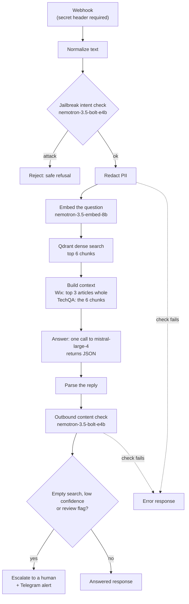

# Architecture

TriagePilot is a retrieval-augmented triage pipeline built in n8n. It answers a customer support question from a knowledge base, or hands it to a person when it should not answer. It is deployed on two knowledge bases, Wix help-center articles and IBM TechQA notes, as two examples of the same design. Each deployment has its own workflow, Qdrant collection and webhook, so changing one never touches the other.

## Request path, step by step

| Step | What happens | Typical time |
|---|---|---|
| Webhook | Accepts a POST with `{"text": "..."}` and the header `X-TriagePilot-Key`. | 0 s |
| Jailbreak intent check | A small guard model decides whether the message is an attack (prompt injection, system prompt extraction, role play). Attacks get a safe refusal. | 0.4 s |
| Redact PII | n8n's guardrails node replaces personal data such as emails and phone numbers with placeholders. | under 0.1 s |
| Embed question | The customer's own words (first 6,000 characters) go to `nvidia/nemotron-3.5-embed-8b` as a query. Only the first 2,048 dimensions are kept and the vector is re-normalized. There is no query rewriting. | 0.7 s |
| Search | Qdrant returns the 6 closest chunks by cosine similarity. No reranker, no keyword search. | 0.1 s |
| Build context | TechQA uses the 6 chunks as they are. Wix reads the top 3 distinct articles whole (at most 12,000 characters each, 60,000 in total) and adds the remaining chunks. | under 0.1 s |
| Answer | One call to `mistral-large-4` (hosted on NVIDIA, reasoning effort low, temperature 0). The reply is a JSON object: `answer`, `confidence`, `needs_handoff`, `needs_human_review`, `cited_source`. | 40 to 150 s on the free endpoint |
| Parse | A small code step ("Parse Answer") reads the JSON reply. | under 0.1 s |
| Outbound content check | The same guard model checks the reply before it leaves. | 1 s |
| Escalation rule | The case is escalated when the search returned nothing, the model reports low confidence, or it sets `needs_human_review`. An escalation sends a Telegram alert. | under 0.1 s |

Almost all of the waiting is the answer call, which in this deployment goes to a shared free endpoint. A trace of a real request (see [operations](operations.md)) shows 41 of 43.6 seconds in that one step, and the rest of the pipeline takes a few seconds. Latency is therefore set by the model endpoint that is plugged in.

## What it is built from

| Piece | Choice | Why |
|---|---|---|
| Orchestration | Self-hosted n8n in Docker | Visual workflow, webhook trigger, easy to export as JSON. |
| Vector store | Qdrant, one collection per dataset: `wix_help_center_docs_nemo` (5,964 chunks from 1,200 articles) and `techqa_docs_nemo` (3,772 chunks from 496 technotes) | Self-hosted, exact cosine search. |
| Embeddings | `nvidia/nemotron-3.5-embed-8b`, article title added to every chunk text, 2,048 dimensions | Put the right Wix article in the top 3 for 187 of 200 questions, against 165 for the previous embedding model ([experiments](experiments.md)). |
| Answer model | `mistral-large-4` hosted on NVIDIA | The only change that cut wrong answers sent in the model comparison. |
| Guard model | `nvidia/nemotron-3.5-bolt-e4b` for the input and output checks | Fast, and caught 42 of 42 attacks in testing ([security tests](security-tests.md)). |
| Tracing | n8n OpenTelemetry export to Jaeger | One trace per request, one span per node. |

## Design decisions

- **A fixed pipeline, not a loop.** The system searches once and answers once. This keeps every request to one model call, makes retrieval repeatable for the same question, and keeps the cost and failure modes easy to reason about.
- **The model may decline.** Low confidence or a review flag routes the case to a person. In the answer model comparison, the larger model mostly turned wrong answers into hand-offs, which is the behaviour the escalation rule is built for.
- **Checks fail closed.** If the PII check or the outbound check itself fails, the caller gets an error response, not an unchecked answer.
- **Two knowledge bases, one design.** Wix articles are long and the answer often sits outside the best chunk, so Wix reads whole articles. TechQA technotes are short and whole-article context did not help (see experiments), so TechQA keeps the 6 chunks.

## Using the design on another knowledge base

Only the two deployments above were built and evaluated. A third would start from a copy of a workflow and change three things:

- **Collection:** build a new Qdrant collection from the documents with `eval/ingest/build_collections.py`, and put its name in the search step.
- **Webhook:** give the copy its own webhook path.
- **Context:** choose chunks or whole articles. This depends on how long the documents are and where answers sit, and it should be measured, as it was for Wix and TechQA.

## Known limits

- There is no feedback loop and no conversation memory: each request stands alone.
- The answer prompt contains two lines that refer to tools the pipeline does not use. They are harmless and were kept because the evaluation measured that exact prompt.
